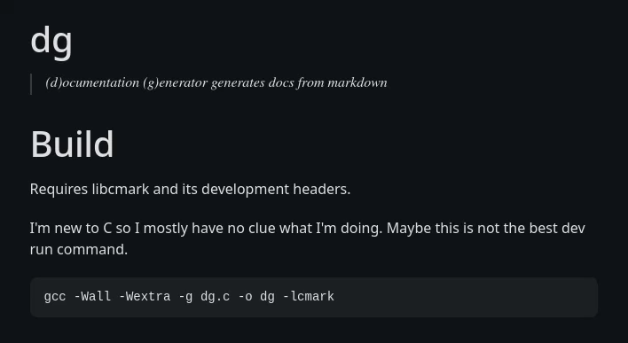

# dg
> (d)ocumentation (g)enerator generates docs from markdown



# Build

Requires libcmark, its development headers, and static libraries for libcmark and libc.

I'm new to C so I mostly have no clue what I'm doing. Maybe this is not the best dev run command.

```bash
gcc -Wall -Wextra -g -static dg.c -o dg -lcmark
```

# Usage

```text
./dg [INPUT_DIR [OUTPUT_DIR [CSS_FILE]]]
```

Defaults to the current directory and `output`. CSS is optional.

```bash
./dg input output marx.min.css
./dg --help
```

# LICENSE
[MIT](LICENSE)
